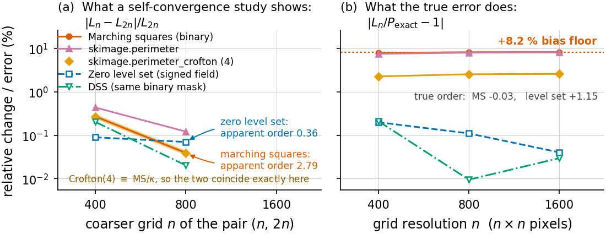

<div align="center">

# Your Ground Truth Is Running the Same Biased Estimator as Your Method

### Incorporation Bias in the Geometric Evaluation of Segmentation Pipelines

[](https://www.latinxinai.org/)
[](paper/foliar_fem_lxai_cameraready.pdf)
[](https://github.com/jossuema/foliar-fem/actions/workflows/validate.yml)
[](docs/validate_output.txt)
[](pyproject.toml)
[](LICENSE)

**Manuel Josue Malla Campoverde** &nbsp;·&nbsp; **Eduardo Tusa**

Universidad Técnica de Machala &nbsp;·&nbsp; Machala, Ecuador

[**Paper**](paper/foliar_fem_lxai_cameraready.pdf) &nbsp;|&nbsp;
[**Reproduce every number**](#reproducing-the-paper) &nbsp;|&nbsp;
[**Figures**](paper/fig) &nbsp;|&nbsp;
[**Validation log**](docs/validate_output.txt)

</div>

---

> **TL;DR** — If your synthetic ground truth measures perimeter the same way your
> method does, refining the reference grid will not save you. The shared
> estimator has a bias *floor*, so the error converges beautifully to the wrong
> number. On our test shape binary marching squares **self-converges at order
> 2.79 while its true error sits at a constant +8.20 %**. In our own leaf
> pipeline that hid a **+4.55 %** perimeter error behind a reported **−0.01 %**,
> and made a flat-mesh extractor look like it beat a raster baseline while being
> nearly three times worse.

<div align="center">

</div>

## The failure

A reference estimator is supposed to be independent of the method it judges. The
usual check is a refinement study: shrink `h`, watch the error fall, conclude the
reference is converged. That check cannot detect a bias the reference and the
method **share**.

Three things follow, and all three are measured in this repository:

1. **Self-convergence is not convergence.** Richardson extrapolation on the
   reference alone reports order 2.79 — textbook behaviour — for an estimator
   whose error never leaves +8.20 %.
2. **Independence of implementation is not enough.** Four-direction discrete
   Crofton, the remedy most of the stack recommends, is *exactly* marching
   squares divided by Kulpa's constant on saddle-free masks. Two different code
   paths, one bias.
3. **Cancelling biases read as accuracy.** A +3.87 % digitisation bias on top of
   a −7.69 % projection bias looks like −4.12 % of total error, which is better
   than the baseline's −8.91 %. It is not better. It is two mistakes with
   opposite signs.

## Key results

Perimeter of the same synthetic leaf, each level compared against **the reference
that level can actually reach** — raster and flat mesh see the projection, only
the lifted mesh can aspire to the intrinsic value. Mixing the two is what
produced the inversion.

| Estimator | Reachable reference | Measured | Digitisation error |
|---|---:|---:|---:|
| Raster · Crofton, 4 directions | 686.98 cm (projected) | 677.90 cm | **−1.32 %** |
| Flat mesh · continuous contour | 686.98 cm (projected) | 713.54 cm | **+3.87 %** |
| Lifted mesh · 3D contour | 744.23 cm (intrinsic) | 778.06 cm | **+4.55 %** |

Reproduced over five seeds: raster **−1.35 ± 0.44 %**, flat mesh
**+3.79 ± 0.37 %**. The sign and the order of magnitude are stable, not an
accident of one seed.

A multigrid-convergent replacement — digital straight segments, run on the same
binary masks — removes the bias instead of calibrating it away:

| Estimator on the binary mask | Error over 5 seeds |
|---|---:|
| **DSS (convergent)** | **−0.42 ± 0.11 %** |
| Marching squares (default stack) | +4.06 ± 0.46 % |
| Crofton, 4 directions | −1.35 ± 0.44 % |

And the failure is worse in 3D: **PyRadiomics returns sphericity 0.919 for a
perfect digital sphere, at every resolution.**

## Installation

```bash
git clone https://github.com/jossuema/foliar-fem.git
```

```bash
cd foliar-fem && pip install -r requirements-lock.txt
```

`requirements-lock.txt` pins exact versions. This matters more than usual here:
the mesh is sensitive to the solver stack, and a different set of versions gives
20,989 triangles instead of 20,917 — and everything measured on the mesh moves
with it. Use `requirements.txt` only if you accept that drift.

## Quick start

```bash
python3 demo.py
```

Synthetic leaf → masks → constrained Delaunay mesh → P1 FEM → agronomic
parameters, with the error of all three levels against exact ground truth.
Writes figures and tables to `out/`. Takes about 11 s.

```bash
python3 validate.py
```

66 numerical checks against closed-form solutions. **This is the safety net: if
a change turns it red, the change is wrong until proven otherwise.** It tests
mathematical properties, not memorised values, so a correct change does not move
it. Takes about 48 s; the last green run is in
[`docs/validate_output.txt`](docs/validate_output.txt).

```bash
python3 demo_infeccion.py
```

Anisotropic reaction-diffusion of the lesion over the surface, with the latency
compartment that anchors the time axis. Takes about 21 s.

## Reproducing the paper

Every quantitative claim in the paper has a command that regenerates it. All of
them live in [`paper/scripts/`](paper/scripts) and run from any working
directory.

| Claim in the paper | Command |
|---|---|
| Self-convergence at order 2.79 vs. constant +8.20 % error | `python3 paper/scripts/twogrid.py` |
| Three-grid screening test, and what it misses | `python3 paper/scripts/twogrid.py shapes` |
| Crofton-4 ≡ marching squares / Kulpa, residual zero | `python3 paper/scripts/crofton.py` |
| Closed-form ranking-inversion condition, by Monte Carlo | `python3 paper/scripts/inversion.py` |
| Arc-length vs. uniform orientation averaging | `python3 paper/scripts/avg.py` |
| Convergent DSS estimator, five seeds | `python3 paper/scripts/dss.py leaf` |
| Robustness of the inversion under boundary noise | `python3 paper/scripts/noise.py` |
| PyRadiomics sphericity on a digital sphere | `python3 paper/scripts/surf3d.py` |
| The original, biased ground truth | `python3 paper/scripts/oldgt.py` |
| Paper figures | `python3 paper/scripts/figs.py` |

To rebuild the PDF: `cd paper && make paper.pdf` (needs a LaTeX distribution).

## What this repository is, beyond the paper

The paper is a methodological finding. It came out of building something else: a
pipeline that turns 2D segmentation masks of a banana leaf with black sigatoka
into agronomic parameters, through constrained Delaunay triangulation and P1
finite element operators, and then solves an anisotropic reaction-diffusion
equation for lesion expansion on that surface.

The pipeline runs at **three levels, on purpose, and they must not be merged** —
each isolates one cause of error:

| Level | What it does | What it still cannot see |
|---|---|---|
| **A · raster** | pixel counting, Crofton perimeter, fast-marching geodesics | the curl, and it crosses tears |
| **B · flat mesh** | continuous geometry, respects tears | the curl: it still measures the projection |
| **C · lifted mesh** | corrects the curl too | needs `R` from an external source |

What phase 1 found, measured rather than assumed, and some of it against the
project's own expectations:

- **Area does not justify meshing.** Levels A and B both give −10.76 %, because
  the error is projection and neither corrects it.
- **Perimeter justifies the 3D lift, not planar continuous geometry.** Level B
  does worse than Crofton at the same job, by a factor 3.
- **Geodesic distances do justify meshing.** The default method reaches +0.22 %
  with RMSE 0.084 cm against a reference eikonal field — and it is plain
  Dijkstra on the 2-ring graph, which beats the heat method by a factor 7.2 even
  with the heat method at its measured optimum.
- **The 3D correction needs `R` to ±5 %.** Inside that band the area error stays
  under 2 %; `R` is not recoverable from a single view.
- **Latency makes `β₀` larger, not smaller**, and in doing so invalidates the
  two-photo field protocol the project itself proposed: with τ_E = 38 days, a
  21-day window leaves 82.4 % of the observed increment explained by the
  pre-existing latent pool.

## Repository layout

```
foliar/
  synth.py      parametric synthetic leaf with exact ground truth
                (including the zero-level-set reference perimeter)
  meshing.py    mask -> subpixel contour -> planar partition -> CDT mesh
  fem.py        P1 gradients, cotangent stiffness, mass, geodesics
  params.py     agronomic parameters + Stover-Gauhl scale
  infection.py  lesion expansion PDE: anisotropic diffusion + reaction
  latency.py    latency compartment S -> E_1..E_k -> I, separating
                colonised tissue from visible tissue
  baseline.py   raster reference methods (the fair rival, not a straw man)
  pipeline.py   orchestrates the three levels A/B/C
  viz.py        figures
demo.py             full pipeline run
demo_infeccion.py   lesion expansion simulation, with latency
validate.py         66 numerical checks
paper/              LaTeX source, figures, and every script behind the tables
docs/               results and the last green validation log
```

## Limitations

Stated here as plainly as in the paper, because they bound what the numbers mean:

- Everything rests on **one synthetic leaf model**. Five seeds are five
  realisations of one parametric generator, so the spread is within-model
  variability, not generalisation.
- **No real image and no predicted mask** enters this work. The inversion shows
  that a biased reference *can* reorder a comparison — not how often, nor how
  large that reordering is in the field.
- The winning baseline is **shape-specific**; Crofton is itself non-convergent.
- Our DSS estimator **degrades under boundary noise** too.
- The anisotropy ratio comes from the generator's own elongation, so phase 1
  validates the **numerical scheme**, not the biology.
- `τ_E = 38 d` rests on a **single primary source**, from a different region and
  management system than the simulated leaf. It is the most fragile parameter in
  the temporal model.

## Citation

```bibtex
@inproceedings{malla2026groundtruth,
  title     = {Your Ground Truth Is Running the Same Biased Estimator as Your
               Method: Incorporation Bias in the Geometric Evaluation of
               Segmentation Pipelines},
  author    = {Malla Campoverde, Manuel Josue and Tusa, Eduardo},
  booktitle = {LatinX in AI (LXAI) Research Workshop at NeurIPS},
  year      = {2026}
}
```

For the software itself, see [`CITATION.cff`](CITATION.cff).

## License

[MIT](LICENSE).
